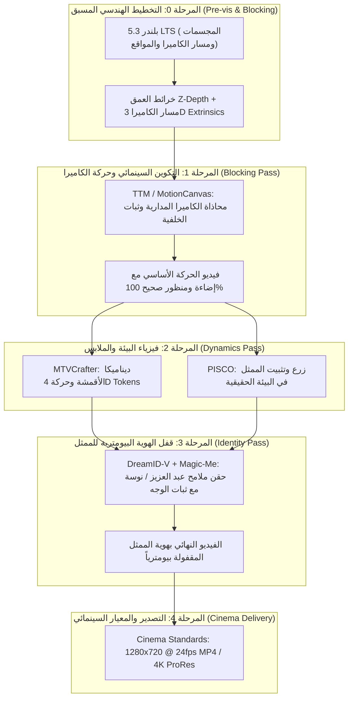

# المعمارية الموحدة لمحرك سيندي الهجين
# The Unified Cindy Multi-Pass Directorial Pipeline (Cindy-V-Pipeline)

> **وثيقة التصميم الهندسي والمعماري المعتمد | المخرج: إيهاب فكري (Ehab Fikry)**
> **تاريخ التحديث والاعتماد:** 16 نوفمبر 2026

---

## 1. فلسفة خط الإنتاج الإخراجي (The Directorial Pipeline Philosophy)

بدلاً من الوقوع في فخ النماذج الشبكية الأحادية (Monolithic Fusion) التي تؤدي إلى تداخل الأوزان (Weight Interference) وتشوه الملامح، يعتمد **محرك سيندي الإخراجي المتسلسل** على فلسفة هوليوود في المؤثرات والإنتاج (Multi-Pass Compositing):
فصل المسؤوليات في مراحل متتالية وواضحة (Passes)، لكل مرحلة مهمة سينمائية محددة بنسبة 100%، وتتشارك جميعها نفس العمود الفقري الرياضي (**Wan 2.1 DiT + DiffSynth-Studio**).

---

## 2. المراحل الأربعة لخط الإنتاج الإخراجي (The 4 Directorial Passes)

### 🎬 المرحلة 1: مسار الكاميرا والتكوين (Pass 1: Camera & Spatial Blocking)
* **المسؤول**: `Blender 5.3 LTS` + `Doubiiu/MotionCanvas` أو `time-to-move/TTM`.
* **الوظيفة**:
  - تصدير زوايا الكاميرا (Focal Length, Elevation, Azimuth, Distance).
  - تحديد موقع الممثلين (عبد العزيز 1.84m، رجب 1.86m).
  - توليد الفيديو التأسيسي الثابت بدون أي اهتزاز للمنظور.

### 👗 المرحلة 2: ديناميكية الملابس والزرع (Pass 2: Wardrobe Dynamics & Environmental Insertion)
* **المسؤول**: `DINGYANB/MTVCrafter` + `taco-group/PISCO`.
* **الوظيفة**:
  - محاكاة فيزياء السترات الفرو والملابس الفضفاضة بحسابات حركية رباعية الأبعاد (4D VQ-VAE Tokens).
  - زرع الممثلين في خلفيات وشوارع حقيقية بمحاذاة العمق المكاني بدون تداخل بصري.

### 👤 المرحلة 3: قفل الهوية البيومترية الصارم (Pass 3: Biometric Identity Injection)
* **المسؤول**: `bytedance/DreamID-V` + `Zhen-Dong/Magic-Me`.
* **الوظيفة**:
  - استقبال الفيديو المولد من المرحلة السابقة كـ `driving_video`.
  - حقن صورة المرجع الأصلية لوجه الممثل (مثل عبد العزيز) وتثبيتها بدقة بيومترية لا تهتز، مع تطبيق مصفوفة التغاير الزماني (`cov_alpha=0.05`).

### 🎞️ المرحلة 4: المعالجة والإنهاء السينمائي (Pass 4: Master Delivery)
* **المسؤول**: `cindy_engine/postprocess/cinema_standards.py`.
* **الوظيفة**:
  - توحيد معدل الإطارات عند المعيار السينمائي الإلزامي (24.0 fps).
  - دقة عالية 720p HD قابلة للترقية لـ 4K بنسبة 16:9 أو CinemaScope 2.39:1.

---

## 3. البنية السحابية التجارية الاقتصادية (Commercial Cloud Architecture)

### التحدي السابق:
إقلاع الـ Pod في كل مرة كان يتطلب إعادة تحميل المكتبات والأوزان الضخمة (15GB إلى 25GB) مما يستغرق 3 إلى 5 دقائق انتظار.

### الحل السحابي المعتمد:
1. **وحدة التخزين السحابية الدائمة (RunPod Network Volume)**:
   - تخصيص وحدة تخزين بحجم 50GB متصلة بمركز البيانات (بتكلفة رمزية ~ 3$ شهرياً).
   - توضع فيها جميع أوزان النماذج الـ 8 مرة واحدة مسبقاً (`/workspace/models/`).
2. **صورة دوكر موحدة سريعة الإقلاع (`Dockerfile.wan_diffsynth`)**:
   - بيئة مبنية مسبقاً تضم `PyTorch 2.4`, `CUDA 12.4`, `DiffSynth-Studio`, و `Flash-Attention 2`.
3. **زمن الاستجابة والتكلفة**:
   - يبدأ كارت الشاشة (RTX 4090 / A100) الريندر في **أقل من 10 ثوانٍ** من لحظة ضغط زر "توليد".
   - تكلفة اللقطة الواحدة تتراوح بين **$0.03 إلى $0.05** فقط، مع إغلاق آلي للكارت فور انتهاء المشهد.

---

## 4. خارطة طريق التنفيذ (Action Plan)
* [x] ربط Blender 5.3 LTS محلياً لاستخراج زوايا الكاميرا وخرائط العمق Z-Depth.
* [x] دمج واجهة الأدوات المفتوحة الـ 8 في المعمل المجاني مع بطاقات مواصفات حية.
* [x] برمجة منسق المراحل المتسلسلة `CindyDirectorialPipeline` في البايثون.
* [ ] تجهيز ملف إعداد حاوية الريندر السريعة مع RunPod Network Volume.
